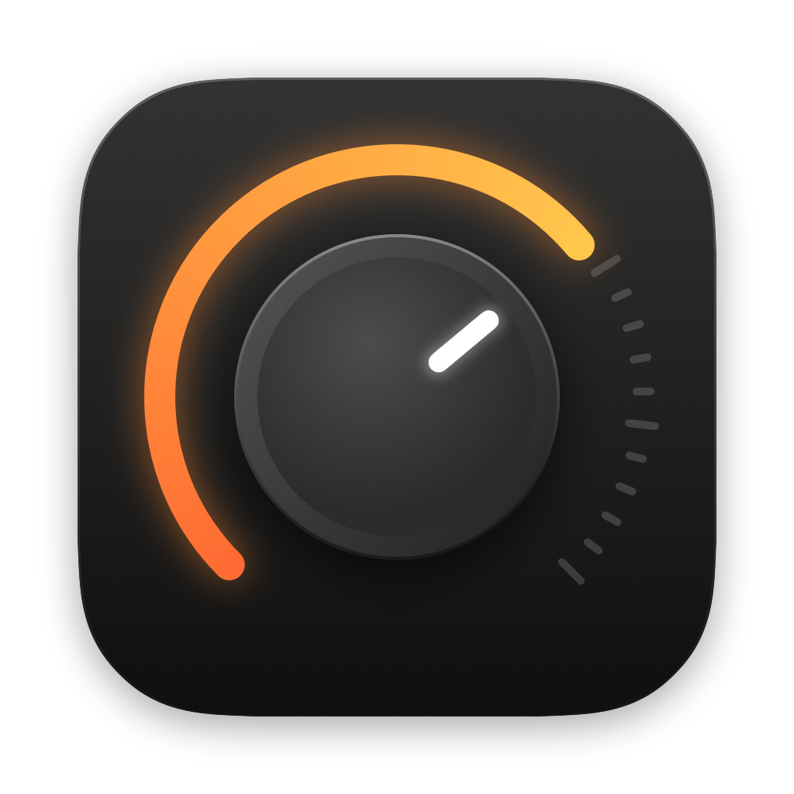
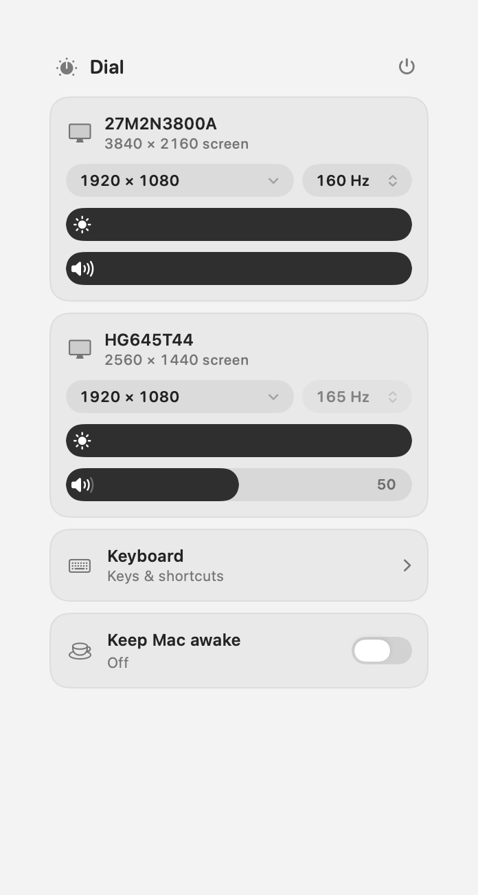

<p align="center">
  
</p>

<h1 align="center">Dial</h1>

<p align="center">
  <b>Brightness, volume and screen size for your external monitors — plus keyboard shortcuts and screenshots.</b>
</p>

<p align="center">
  <a href="https://github.com/Eroyun/dial/releases/latest/download/Dial.dmg">
    
  </a>
</p>

<p align="center">
  <a href="https://github.com/Eroyun/dial/actions/workflows/ci.yml"></a>
  <a href="https://github.com/Eroyun/dial/releases/latest"></a>
  
  
  <a href="LICENSE"></a>
</p>

<p align="center">
  <picture>
    <source media="(prefers-color-scheme: dark)" srcset="docs/panel-dark.png">
    
  </picture>
</p>

## What it does

- ☀️ **Brightness** — changes the monitor's real backlight. Screens that don't allow that (often behind adapters) get their picture dimmed instead.
- 🔊 **Volume** — for monitors with speakers.
- 🔍 **Screen size** — see your screen's real resolution, pick how big everything looks from a short list, and choose the refresh rate.
- ⌨️ **Keyboard keys** — your Mac's brightness and volume keys work on the monitor too. Assign screenshot actions or custom shortcuts to other keys.

No account or internet needed.

**Keep Mac awake:** turn on the switch in Dial. macOS asks for administrator
authorization once to install its sleep helper. Later toggles and app restarts do
not ask again. Dial remembers the switch and resumes when reopened if it was on.
It works on battery with no charger, monitor, or other device connected. The display
can still turn off. Turn the switch off before carrying the Mac in a bag; it keeps
using battery with the lid closed. Turning it off or quitting Dial restores normal
sleep.

The helper accepts sleep-session requests only from the signed Dial app. It
watches each session's process and heartbeat, restores sleep after a lost
connection, and rechecks the setting across power changes. It changes only
`SleepDisabled`, restoring false (saving an explicit false key when it was
previously absent); ordinary sleep timers are preserved. Helper death, a system
crash, shutdown or an unrelated power-setting writer can prevent restoration.
If needed, recover with `sudo pmset -a disablesleep 0`. The administrator password
is never stored. No software can prevent shutdown from an empty battery or
hardware failure.

Dial rechecks displays after reconnect and wake, and remembers size and refresh changes made in System Settings as well as in Dial.

## Install — 4 steps, no Terminal

1. Click **[Download Dial](https://github.com/Eroyun/dial/releases/latest/download/Dial.dmg)**.
2. Open the downloaded **Dial.dmg** and drag **Dial** onto the **Applications** folder.
3. Open **Dial** from your Applications folder. The dial icon appears at the top of your screen, next to the clock.
4. Click the dial icon. That's it.

<details>
<summary><b>Mac says "Dial Not Opened" or "Apple could not verify"?</b></summary>

Dial is free and isn't sold through Apple, so macOS asks you to confirm once:

1. Click **Done** on the message.
2. Open **System Settings → Privacy & Security**.
3. Scroll down and click **Open Anyway** next to Dial, then enter your Mac password.

You only do this once.
</details>

## Turning on keyboard control

Brightness, volume and screen size work right away. Click **Set Up** on the **Keyboard keys** card, and Dial opens System Settings for you:

1. Turn on the switch next to **Dial**.
2. That's it. Dial notices by itself, the keys work from then on, and the card goes away.

## Questions

**How do I assign an action to a keyboard key?**
Click **Keyboard** in Dial. Click a key in the keyboard view, or choose **Press a key…** to identify the actual key and any held modifiers. Choose an action and click **Save mapping**. For a custom action, record the destination shortcut first. You can edit, disable or remove each mapping.

Print Screen / F13 and Control–Print Screen / F13 use macOS screenshot selection. Assign Scroll Lock / F14 and Control–Scroll Lock / F14 to Dial's scrolling screenshot actions in Keyboard:

| Key | Action |
| --- | --- |
| Print Screen / F13 | Select an area with macOS's native screenshot tool (**Command–Shift–4**). |
| Control–Print Screen / F13 | Select an area with macOS's native screenshot tool and copy it to the clipboard (**Control–Command–Shift–4**). |
| Scroll Lock / F14 | Run Dial's scrolling capture on the focused page and open its preview. |
| Control–Scroll Lock / F14 | Run Dial's scrolling capture on the focused page and copy the finished image to the clipboard. |

The Print actions call macOS’s built-in screenshot tool directly, so they do not depend on synthesized system shortcuts. The Print mappings are defaults for a new mapping store; existing or edited mappings take precedence. Scroll mappings can be assigned as **Scrolling screenshot** and **Copy scrolling screenshot**. Scrolling capture requires Screen Recording permission as well as Accessibility permission; macOS screenshot selection uses the native tool. Keyboard modes may send different key codes, so record a key to confirm. Scrolling capture chooses the nearer endpoint when the app exposes its position, reaches that endpoint before composing, then captures toward the other end. Upward captures export in normal reading order using the same strict overlap checks. If position is unknown, Dial seeks the top and verifies it before capture. Endpoint seeking uses a separate bounded large wheel request, while capture and rollback keep small overlapping steps. Dragged selections target the center of the selected content rather than the drag anchor. Mappings apply to all connected keyboards. Modifier keys by themselves and media keys are not assignable in this editor.

The keyboard editor requires Dial's existing Accessibility permission. Recording accepts one shortcut only while its window is active; it does not keep a history of typed keys. Mappings are saved locally and can be turned off together using the **Mappings** switch.

**Can Num Lock disable the whole numpad?**
Yes. Num Lock / Keypad Clear toggles the numpad between enabled and disabled. The **Numpad** switch shows the same saved state. Disabling it blocks digits, decimal, operators and keypad Enter, including new custom mapped keypad presses; already held presses complete their releases. The software state does not establish the physical Num Lock LED state. Assigning a custom action to Num Lock itself intentionally overrides its toggle.

**Can an AI change my shortcuts without clicking through the app?**
Yes. `/Applications/Dial.app/Contents/MacOS/Dial --keyboard help` returns the JSON command interface and examples. `--keyboard list` inspects saved mappings; `--keyboard assign --key print --action screenshot-selection` assigns Print Screen. Changes reload in the running app without restarting display control. The installed `Contents/Resources/KeyboardAutomation.md` documents the interface and its limits.

**Can I update the AULA F108 Pro screen clock on macOS?**
Use a data-capable USB cable and select wired mode. `Dial --aula-clock status` checks the compatible control interface without sending reports. `Dial --aula-clock sync --timezone Europe/Bucharest` sends the local date/time to the only compatible keyboard automatically; multiple matches require `--device` with a registry ID returned by status. This clock-only path uses the documented reverse-engineered four-report sequence, never image or firmware commands. The built-in LCD date order has no documented format setting in this interface.

**Can I use Control Center instead?**
No. Apple doesn't let apps add external-monitor sliders to Control Center, so Dial lives in the menu bar instead.

**Brightness on one monitor only makes the picture darker.**
That monitor, or the adapter it's on, blocks the signal Dial uses to set the backlight, so Dial dims the picture instead. Connecting it straight to the Mac with USB-C or HDMI often gets real backlight control back.

**I want more screen sizes than the list shows.**
Dial shows every size macOS offers for your monitor (when a size comes both sharp and blurry, only the sharp one). Dial does not create additional display modes.

**How do I make Dial start with my Mac?**
Right-click the dial icon and choose **Open at Login**.

## For developers

```bash
git clone https://github.com/Eroyun/dial.git && cd dial
./scripts/build-app.sh --install   # builds Dial and puts it in Applications (needs Xcode Command Line Tools)
/Applications/Dial.app/Contents/MacOS/Dial --probe   # what Dial sees, for bug reports
/Applications/Dial.app/Contents/MacOS/Dial --diagnose   # passive inventory, without DDC reads or changing settings
```

`--diagnose` lists online displays, rendering sizes, refresh rates, remembered modes and USB product names. Rendering size may differ from the actual signal resolution, and USB devices are not automatically paired with video displays. For an already-confirmed setting, `Dial --save-current "monitor name" 160` remembers the current mode only if the named display is currently at 160 Hz; it does not change the video settings.

How it works:
- **Brightness and volume** use DDC/CI, which is the monitor's own control channel over the video cable. On Apple silicon it goes through `IOAVService`, and each screen is matched to its channel through the IO registry.
- **Screen size** switches between the display modes macOS reports, using `CGConfigureDisplayWithDisplayMode`.
- **Keyboard mappings** match exact key/modifier combinations at the session event tap, transform the matching press and release, and suppress action repeats. Unmapped combinations pass through normally. The mapping policy and persistence checks run with `swiftc -swift-version 5 Sources/Dial/KeyboardMappings.swift Tests/KeyboardMappingsTests.swift -o /tmp/dial-keyboard-tests && /tmp/dial-keyboard-tests`.

See [CONTRIBUTING.md](CONTRIBUTING.md) to help out.

## Credits

DDC on Apple silicon was pioneered by [MonitorControl](https://github.com/MonitorControl/MonitorControl) and [m1ddc](https://github.com/waydabber/m1ddc).

## License

[MIT](LICENSE)
